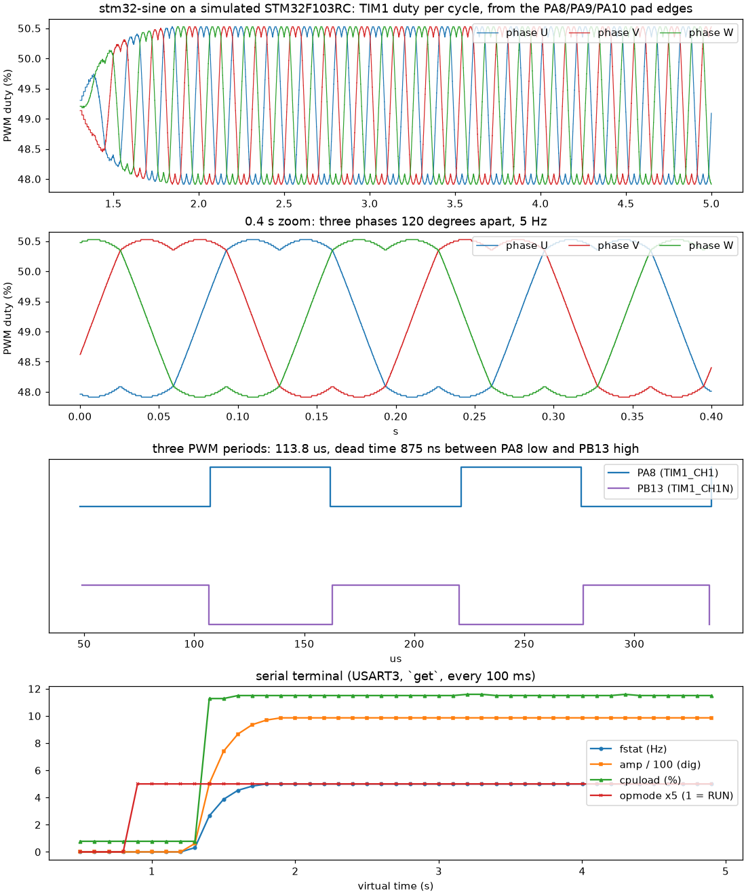

[](../../actions/workflows/CI-build.yml)

# stm32-sine

<!-- simantic-banner -->
> **Run this firmware with no hardware.** [Simantic](https://simantic.com) simulates the whole board, peripherals, sensors and buses included. Try it free at **[simantic.com](https://simantic.com)**, or run it locally: `curl -fsSL https://simantic.com/install | sh`

## This fork: the inverter firmware on a simulated STM32F103RC

Simantic's fork of jsphuebner's stm32-sine. Upstream commit `47298e0` (SINE build, `make get-deps && make`) runs
unmodified on a simulated STM32F103RC, driven over its serial terminal (USART3) and CAN1, with the TIM1 PWM pads recorded.
No board, no motor. Everything is in [`sim/`](sim/).

```
cd sim && ./run.sh      # needs `sim` with STM32F103 support on PATH; the plot needs python3 + matplotlib
```



**Measured, from a real run** ([`sim/run.log`](sim/run.log), [`sim/measured.txt`](sim/measured.txt); 5 s of virtual time in about
8 s of wall clock):

- The firmware boots, detects `hwver` 0 (HW_REV1: the bare chip's PC9 pad floats), and starts its 10 ms and 100 ms tasks.
- Terminal: `set` / `get` / `can tx` answer over USART3 at 115200 8N2; 45 polled `get` lines parse back into columns.
- A scripted key switch on PB6 (0.8 s) takes it to `opmode` 1 (RUN); after the firmware's 500 ms init wait TIM1 starts at 1.306 s.
- TIM1 (center-aligned, `pwmfrq` 1): period 113.78 us = 8.79 kHz (72 MHz / 2 / 4096) on PA8/PA9/PA10, 32468 cycles each.
- Dead time between PA8 low and PB13 (CH1N) high: 875 ns = `deadtime` 63 x 13.9 ns at 72 MHz.
- Duty per phase swings 47.9 % to 50.5 % at `fstat` 5 Hz with `amp` 986 dig; phases 120 degrees apart, with the
  common-mode offset of the firmware's SVPWM (`SineCore::CalcSVPWMOffset`). The 49.2 % mean is 50 % minus the dead time (0.77 %).
- CAN: after `can tx fstat 384 0 16 1` and `can tx amp 385 0 16 1`, a scripted node receives 46 frames of 0x180 and 45 of 0x181
  every 100 ms; the last ones decode to 5 Hz and 986, equal to the terminal values.
- The firmware's own `cpuload` reads 11.5 % (sine ISR plus tasks) in RUN.

**Scripted, not modelled** (no physics plants; all of this is time-tabled stimulus):

- `io_peer.py`: emergency-stop loop closed (PC7) at 0, forward select (PA4) at 0.4 s, start key (PB6) at 0.8 s.
- `term_peer.py`: types the `set` and `can tx` commands and polls `get` every 100 ms.
- `can_peer.py`: only listens and logs.

**What does not work / is not shown**

- **No ADC input.** The F103 ADC has no `analog:` input in this sim ([pyrite#3810](https://github.com/simantic-dev/pyrite/issues/3810)),
  so DC link voltage, throttle pedal and phase currents all read 0. The demo therefore lowers `udcsw` and `udcmin` to 0 and picks the
  operating point with the motor parameters `boost` (10000) and `fslipmin` (5 Hz) over the terminal instead of a throttle.
  The current limiter, throttle ramp, udc and temperature derating are not exercised.
- No motor, encoder or resolver: `speed` stays 0 and the stator frequency is the slip frequency alone.
- **Needs a pre-release sim.** STM32F103 is not runnable in released `sim` 0.10.4. The numbers above come from a pyrite
  build (`sim 0.10.0`, commit `50d3404e`, the F1 model branch, which reports "model is incomplete"). Set `SIM=` to that binary.
- Only the SINE build (`CONTROL=SINE`) is run; the FOC build, flash parameter save and the over-current timer path are untried.
- The HSE crystal is the 8 MHz chip default; the sim warns that the board does not declare it.

# Upstream README

Main firmware of the Huebner inverter project
This firmware runs on any revision of the "Huebner" hardware https://github.com/jsphuebner/inverter-hardware as well as any derivatives as the Open Source Tesla controller https://github.com/damienmaguire

# Goals
The main goal of this firmware is well-drivable control of electric 3-phase motors with as little software complexity as possible. We do not rely on virtual control methods such as FOC (field oriented control) or DTC (direct torque control). This makes tuning more intuitive, as only real physical quantities are parametrized.
The same principle is applied to the hardware design, keeping component count low and therefor minimize cost and failure modes.
To fine tune the driving experience and adapt to different flavours of power stages, over 60 parameters can be customized.

# Motor Control Concept
The idea is that the dynamics of any 3-phase asynchronous motor are controlled by the amplitude of the sythesized sine wave and its frequency offset to the rotor speed (slip). 
For 3-phase synchronous motors a similar control method did not prove practical. Therefor a FOC version of the software has been created. It shares 95% of the code.

# Inverter charging
A unique feature of this software is to re-purpose the drivetrain hardware as a programmable battery charger. One of the motor phase windings is being used as a high current capable inductor and one of the phase switches as a buck or boost converter. This has practically proven to replace a separate charging unit and further reduce complexity of electric vehicles.

# Further reading
A comprehensive guide to the Huebner inverter system can be found here: https://openinverter.org/docs

# Compiling
You will need the arm-none-eabi toolchain: https://developer.arm.com/open-source/gnu-toolchain/gnu-rm/downloads
On Ubuntu type

`sudo apt-get install git gcc-arm-none-eabi`

The only external depedency is libopencm3 which I forked. You can download and build this dependency by typing

`make get-deps`

Now you can compile stm32-sine by typing

`make`

or

`CONTROL=FOC make`

to build the FOC version for synchronous motors.

And upload it to your board using a JTAG/SWD adapter, the updater.py script or the esp8266 web interface
